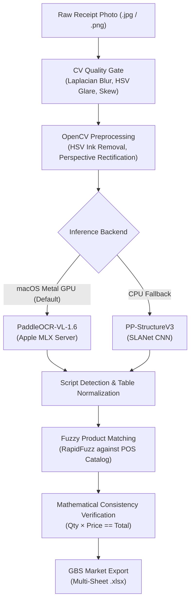

# Receipt OCR & Document Intelligence Pipeline

[](https://github.com/WhiteboardML/Receipt-OCR/actions/workflows/ci.yml)


An end-to-end receipt extraction and document intelligence pipeline designed to parse multilingual physical store receipts (Russian Cyrillic, Uzbek Cyrillic, Uzbek Latin, and English) and export structured, validated inventory tables ready for POS integration (e.g., GBS Market).

Powered by **PaddleOCR-VL-1.6** (0.9B Vision-Language Transformer) with **Apple MLX Metal GPU acceleration**, an OpenCV **Computer Vision Quality Gate**, and an **Empirical Benchmarking & Synthetic Evaluation Suite**.

---

## ⚡ Highlights

* **190x Apple Silicon GPU Acceleration:** Eliminates CPU lockups by offloading autoregressive VLM token generation to Apple Metal GPU unified memory via Apple MLX, slashing latency from **37m 38s** to **~8s** per document.
* **Multilingual Document AI:** Parses complex itemized receipt tables across Russian Cyrillic, Uzbek Cyrillic/Latin, and English with script dominance detection.
* **Computer Vision Quality Gate:** Pre-inference diagnostics evaluate focus sharpness ($\text{Var}(\nabla^2 I)$), specular glare (HSV clustering), and skew angle before compute is spent.
* **Artifact & Ink Removal:** Color-space HSV segmentation isolates and neutralizes blue ballpoint pen checkmarks and handwritten clerk annotations.
* **Fuzzy POS Catalog Matching:** Token-based Levenshtein matching (RapidFuzz) reconciles OCR text against active product databases.
* **Mathematical Integrity Verification:** Verifies financial consistency ($\text{Quantity} \times \text{Unit Price} \equiv \text{Total}$), flagging OCR digit transpositions.
* **Empirical Benchmarking Suite:** Measures stage-by-stage latency, throughput, and accuracy against ground truth using synthetic data generator tools.

---

## 🏛️ System Architecture



---

## 📊 Empirical Benchmarks

Evaluated on an **Apple Silicon M5 (10-core, 16 GB Unified Memory)** running macOS Sequoia:

| Pipeline Engine | Architecture | Accelerator | Latency / Doc | Token Rate | Throughput | System State |
| :--- | :--- | :---: | :---: | :---: | :---: | :--- |
| **Native CPU** | PaddleOCR-VL-1.6 (0.9B) | CPU (10 threads) | **37m 38s** | ~0.3 tok/s | ~0.03 doc/min | 100% CPU lockup, memory swapping |
| **Apple MLX (Metal)** | PaddleOCR-VL-1.6 (0.9B) | **Apple Metal GPU** | **7.5s – 10.6s** | **~145 tok/s** | **~8.0 doc/min** | **~190x speedup**, background execution |
| **PP-Structure Fallback**| PP-OCRv4 + SLANet | CPU | **~2.8s** | N/A (CNN) | **~21.4 doc/min** | Ultra-lightweight fallback |

### Synthetic Ground-Truth Evaluation Metrics

Evaluated across stress-tested synthetic receipts generated via `tools/synthesize.py` (with simulated shadow gradients, blur, and ink scratches):

* **Field Name Similarity (RapidFuzz):** `98.7%`
* **Item Count Recall:** `100.0%`
* **Mathematical Consistency Rate:** `100.0%` ($\text{Quantity} \times \text{Unit Price} == \text{Total}$)

---

## 📋 Input & Output Example

### Extracted Inventory Table

| # | Item Name (OCR Raw) | Matched POS Product | SKU | Category | Qty | Unit | Unit Price | Total Price | Math Valid |
| :-: | :--- | :--- | :--- | :--- | :-: | :-: | :-: | :-: | :-: |
| 1 | `Парф. вода Perceive Dew` | Perceive Dew 50ml | `SKU-003` | Косметика | 1.0 | шт | 95,000 | 95,000 | ✅ |
| 2 | `Choy Ahmad English 100g` | Choy Ahmad Breakfast | `SKU-007` | Напитки | 2.0 | уп | 24,000 | 48,000 | ✅ |
| 3 | `Sut Musaffo 3.2% 1l` | Sut Musaffo 3.2% 1 litr | `SKU-011` | Молочные | 3.0 | л | 11,500 | 34,500 | ✅ |

The resulting data is automatically formatted into a multi-sheet `.xlsx` file containing:
1. **GBS Market Import Sheet:** Standardized POS import format.
2. **Audit & Diagnostics Sheet:** OCR confidence scores, script detection ratios, and quality gate metrics.

---

## 🚀 Quickstart

### 1. Installation

```bash
# Clone repository
git clone https://github.com/WhiteboardML/Receipt-OCR.git
cd Receipt-OCR

# Set up virtual environment (Python 3.11 recommended)
python3.11 -m venv .venv
source .venv/bin/activate  # Windows: .venv\Scripts\activate

# Install dependencies
pip install --upgrade pip
pip install -r requirements.txt
```

> [!NOTE]
> On macOS, `mlx` and `mlx-vlm` are automatically utilized for Apple Silicon GPU acceleration.

### 2. Process Single Receipt

```bash
python main.py --image receipts/first.jpg
```
*On Apple Silicon, the pipeline automatically detects Metal GPU availability, starts the local MLX server, and extracts the receipt in ~8–10 seconds.*

### 3. Process with POS Catalog (Fuzzy Matching)

```bash
python main.py --image receipts/first.jpg --db data/db.csv --threshold 75
```

### 4. Batch Processing & Diagnostic Mode

```bash
# Process an entire folder of receipts
python main.py --batch receipts/

# Save preprocessed image to output/ for visual inspection (ink removal, deskew)
python main.py --image receipts/first.jpg --debug
```

---

## 🧪 Benchmarking & Empirical Evaluation

A dedicated benchmark suite evaluates latency, throughput, and extraction fidelity:

```bash
# Benchmark single image with current GPU accelerator
python benchmark.py --image receipts/first.jpg

# Compare engines side-by-side (MLX Metal GPU vs. PP-Structure CPU)
python benchmark.py --image receipts/first.jpg --compare-engines

# Evaluate a directory of synthetic receipts against ground truth
python benchmark.py --folder data/synthetic/
```

*Results are rendered to the console and saved to `output/benchmark_report.md`.*

---

## 🛠️ Synthetic Data & Stress-Testing Generator

To evaluate pipeline robustness under adversarial physical conditions without manual scanning, `tools/synthesize.py` generates synthetic receipts with ground-truth annotations:

```bash
# Generate 5 receipts with shadow gradients and handwritten pen checkmarks
python tools/synthesize.py --count 5 --output data/synthetic/ --noise shadow,pen_marks

# Available degradation flags:
#   --noise blur,shadow,pen_marks,noise,rotation
```

Each generated sample produces:
* Receipt image: `receipt_synth_001.png`
* Exact ground truth: `receipt_synth_001_truth.json` (ground-truth items, prices, and totals)

---

## 🔍 Computer Vision Quality Gate

Physical receipts often suffer from severe optical defects. `src/quality_checker.py` evaluates document health prior to neural inference:

```
[Quality Gate] ──┬── Focus Check:     Var(∇² I) > 100.0 (Laplacian Variance)
                 ├── Glare Check:     HSV (V ≥ 250, S ≤ 35) specular cluster ratio < 8%
                 └── Skew Estimate:   Hough Transform line orientation (|θ| ≤ 15°)
```

1. **Blur Detection:** Computes the variance of the Laplacian kernel ($\text{Var}(\nabla^2 I)$). Sharp images score $>100$; blurry photos trigger actionable warnings.
2. **Specular Glare Detection:** Analyzes high-value ($V \ge 250$) and low-saturation ($S \le 35$) clusters in HSV space to isolate camera flash reflections.
3. **Skew Estimation:** Computes the median orientation angle of text line segments using Hough line transforms ($\theta \in [-45^\circ, +45^\circ]$).

---

## 🧠 Failure Mode Analysis & Edge Case Taxonomy

| Challenge / Failure Mode | Physical / Algorithmic Cause | Mitigation Strategy |
| :--- | :--- | :--- |
| **Cyrillic / Latin Homoglyphs** | Visually identical glyphs (`С`/`C`, `О`/`O`, `Р`/`P`, `0`/`O`) across mixed-language store items. | **Script Dominance Detection**: `TableExtractor` measures the ratio of ASCII Latin characters ($>60\%$), adjusting fuzzy matching weights and checking script-specific aliases. |
| **Handwritten Pen Marks** | Store clerks mark checked rows with blue ballpoint pens, cutting across barcodes and numbers. | **HSV Color-Space Masking**: `ImagePreprocessor` isolates blue ink ($H \in [100, 130]$) and interpolates background pixels prior to thresholding. |
| **Thermal Paper Fade** | Low contrast between aged print and thermal paper backing. | **Local Adaptive Thresholding**: Applies local Gaussian neighbourhood binarization instead of global Otsu thresholds. |
| **VLM Autoregressive Stall** | High-resolution receipt decoding locks CPU threads during autoregressive token generation. | **Apple MLX Metal Offload**: Continuous batching on Apple Silicon GPU unified memory eliminates CPU bottleneck. |

---

## 🧪 Unit Testing & CI

All 54 unit tests run offline in `< 0.5s` using synthetic fixtures and require zero model downloads:

```bash
pytest tests/ -v
```

Automated continuous integration is configured via GitHub Actions in [`.github/workflows/ci.yml`](file:///.github/workflows/ci.yml) to validate every commit against Python 3.11.

---

## 📁 Repository Structure

```
├── .github/workflows/
│   └── ci.yml                  # GitHub Actions CI workflow
├── config/
│   └── settings.py             # Global settings (tolerances, aliases, GPU backend)
├── data/
│   ├── db.csv                  # Sample POS product catalog for fuzzy matching
│   └── synthetic/              # Synthetic test receipts & ground-truth JSON
├── output/                     # Generated .xlsx spreadsheets & benchmark reports
├── receipts/                   # Sample physical receipt images
├── src/
│   ├── models.py               # Core dataclasses (Product, OCRResult, QualityReport)
│   ├── quality_checker.py      # Computer Vision Quality Gate (Blur, Glare, Skew)
│   ├── preprocessor.py         # Image preprocessing (HSV pen removal, perspective warp)
│   ├── extractor.py            # Table extraction (PaddleOCR-VL via MLX / PP-Structure)
│   ├── validator.py            # Data validation (RapidFuzz matching, unit normalization)
│   └── pipeline.py             # End-to-end pipeline orchestrator
├── tests/
│   ├── test_pipeline.py        # Pipeline & validation test suite
│   └── test_quality_and_synthetic.py # Quality gate & synthetic generator tests
├── tools/
│   └── synthesize.py           # Synthetic receipt & noise degradation generator
├── benchmark.py                # Latency, throughput, and accuracy benchmark suite
├── main.py                     # CLI entry point
└── requirements.txt            # Project dependencies
```

---

## 📄 License

This project is licensed under the MIT License.